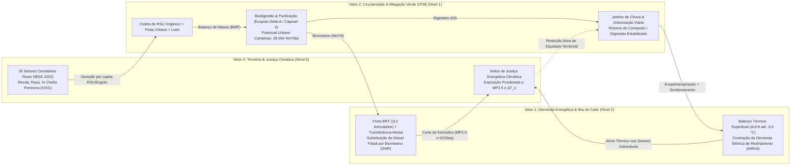

# Gêmeo Digital Urbano-Energético Socioecológico-Circular (Campinas-SP)

**Protótipo Operacional Mínimo Reproduzível — Corredor BRT Campo Grande (Eixo Av. John Boyd Dunlop, Campinas/SP)**  
*NIPE / UNICAMP · CP2B · CPPLEI · Censo IBGE 2022 (`CD_MUN = 3509502`)*

> **Tese Central:** *"Um gêmeo digital urbano socioecológico-circular, orientado à justiça, que otimiza simultaneamente energia de transporte ($V_1$), recuperação de biometano e infraestrutura verde ($V_2$) e redução de exposição térmica e respiratória ($V_3$), sob restrições de equidade intraurbana e incerteza de dados."*

---

## 1. Acoplamento Formal de Massa e Energia ($V_1 \leftrightarrow V_2 \leftrightarrow V_3$)

Diferente da literatura fragmentada (onde modelos microclimáticos/energéticos como o *DUCT/Cooling Singapore*, plantas demonstrativas de biometano como o *LIFE NIMBUS* e índices estáticos de vulnerabilidade como o *EJScreen/HVI* operam isoladamente), esta arquitetura acopla os 3 vetores na escala de **setor censitário ($i \in \{1, \dots, 35\}$)** ao longo dos **17,9 km do Corredor BRT Campo Grande**:



---

## 2. Equações Governantes do Modelo Substituto (*Surrogate Model*)

Para cada setor censitário $i \in \{1, \dots, 35\}$ e variáveis de decisão normalizadas $\theta = (\alpha_{\text{bio}}, \alpha_{\text{verde}}, \alpha_{\text{modal}}) \in [0,1]^3$:

1. **Vetor 2 — Produção Circular de Biometano e Digestato ($\text{Nm}^3/\text{dia}$ e $\text{t}/\text{dia}$):**
   $$Q_{\text{CH}_4, i}(\theta) = \Big( P_i \cdot g_{\text{RSU}} \cdot f_{\text{org}} \cdot Y_{\text{BMP,rsu}} + A_{\text{verde}, i}(\alpha_{\text{verde}}) \cdot Y_{\text{BMP,poda}} \Big) \cdot \eta_{\text{upgrade}}(\alpha_{\text{bio}})$$
   $$M_{\text{digestato}, i}(\theta) = \gamma_{\text{dig}} \cdot \big( M_{\text{RSU,org}, i} + M_{\text{poda}, i}(\alpha_{\text{verde}}) \big)$$

2. **Vetor 1 — Mitigação de Ilha de Calor ($\Delta T_{s,i}$) e Demanda Energética Total ($\text{MJ}/\text{dia}$):**
   $$\Delta T_{s,i}(\alpha_{\text{verde}}) = \Delta T_{s,i}^{(0)} - \Delta T_{\max} \cdot \alpha_{\text{verde}} \cdot \left(0,72 + 0,28 \cdot \Big(1 - \frac{C_{\text{arb}, i}^{(0)}}{40}\Big)\right)$$
   $$E_{\text{tot}, i}(\theta) = E_{\text{transp}, i}^{(0)} \cdot (1 - 0,62 \cdot \alpha_{\text{modal}} \cdot \phi_i) + 3,6 \cdot E_{\text{resf}, i}^{(0)} \cdot \left(0,28 + 0,72 \cdot \frac{\Delta T_{s,i}(\alpha_{\text{verde}})}{\Delta T_{s,i}^{(0)}}\right)$$

3. **Vetor 3 — Exposição Respiratória ($\text{MP}_{2,5}$) e Índice de Justiça Energética-Climática ($\text{IJEC}$):**
   $$C_{\text{MP}_{2,5}, i}(\theta) = C_{\text{MP}_{2,5}, i}^{(0)} \cdot \big(1 - \min(0,78;\; 0,42\alpha_{\text{bio}} + 0,24\alpha_{\text{modal}} + 0,14\alpha_{\text{verde}})\big)$$
   $$\text{IVSG}_i(\theta) = \text{IVSG}_i^{(0)} \cdot \big(1 - 0,52 \cdot (0,28\alpha_{\text{bio}} + 0,38\alpha_{\text{verde}} + 0,34\alpha_{\text{modal}})\big)$$

---

## 3. Como Executar Localmente

```bash
npm install
npm run dev -- --open
```

## 4. Deploy Automático no GitHub Pages

O repositório já inclui o workflow `.github/workflows/deploy.yml` configurado para publicar automaticamente no **GitHub Pages** a cada `git push` na branch `main`.
